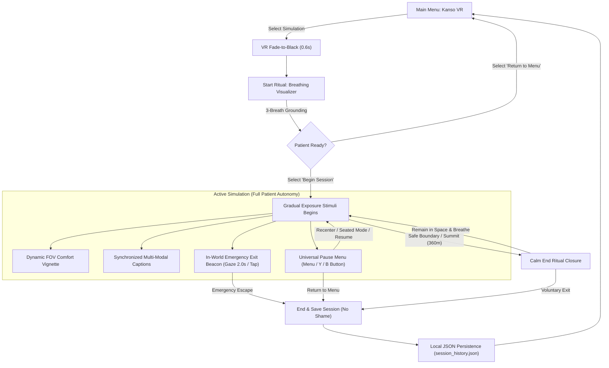

<div align="center">

```
██╗  ██╗ █████╗ ███╗   ██╗███████╗ ██████╗     ██╗   ██╗██████╗ 
██║ ██╔╝██╔══██╗████╗  ██║██╔════╝██╔═══██╗    ██║   ██║██╔══██╗
█████╔╝ ███████║██╔██╗ ██║███████╗██║   ██║    ██║   ██║██████╔╝
██╔═██╗ ██╔══██║██║╚██╗██║╚════██║██║   ██║    ╚██╗ ██╔╝██╔══██╗
██║  ██╗██║  ██║██║ ╚████║███████║╚██████╔╝     ╚████╔╝ ██║  ██║
╚═╝  ╚═╝╚═╝  ╚═╝╚═╝  ╚═══╝╚══════╝ ╚═════╝       ╚═══╝  ╚═╝  ╚═╝

          [ 簡素 · Simplicity, Composure, and Psychological Safety ]
```

# Kanso VR (簡素)
### Therapeutic Virtual Reality Exposure Platform: Simplicity, Composure, and Psychological Safety

[](https://unity.com/)
[](https://www.khronos.org/openxr/)
[](#hardware)
[](ACCESSIBILITY.md)
[](#privacy)
[](LICENSE)

<br/>

**Kanso VR** is an open-source, accessibility-first virtual reality exposure therapy (VRET) platform engineered for clinical healthcare, psychological research, and self-guided emotional regulation. Built from the ground up on the cross-platform **OpenXR** industry standard with **Unity 2022.3 LTS**.

*Kanso* (簡素) embodies the Zen aesthetic of simplicity through the intentional elimination of the non-essential: **no gamified pressure, no startle stimuli, no punitive failure states, and zero sensory overload.**

[Core Vision](#vision) •
[Simulations](#simulations) •
[Architecture](#architecture) •
[Accessibility](#accessibility) •
[Hardware Support](#hardware) •
[Setup Guide](#setup) •
[Documentation](#docs) •
[Citation](#citation)

</div>

---

<a id="vision"></a>
## 🌿 Core Vision & Zen Philosophy

Traditional virtual reality exposure simulations often borrow mechanics from consumer video games: ticking countdowns, flashing red warnings, loud sound effects, and performance scores. For a patient experiencing acute anxiety, panic disorder, or sensory processing sensitivities, these conventions spike autonomic nervous system arousal and induce trauma rather than healing.

**Kanso VR redesigns exposure therapy around composure, autonomy, and quiet dignity:**

- **Spacious & Unburdened:** Clear visual fields with soft, boundaryless twilight lighting ([Direction C Design System](DESIGN_SYSTEM.md)).
- **Patient Agency:** The patient retains 100% control at every micro-moment. Simulations start only when the patient feels settled, and can be paused or exited instantly without shame or penalty.
- **Acoustic Peace:** Zero sudden horns, alarms, or buzzing. Features a procedurally synthesized 432 Hz harmonic ambient drone with zero loop seams.
- **Physical Vestibular Safety:** Automatic seated-mode height compensation, snap turning, dynamic peripheral tunneling vignettes, and physical in-world emergency beacons.

---

<a id="simulations"></a>
## 🧠 Therapeutic Exposure Simulations

```
                      ┌─────────────────────────────────┐
                      │        Kanso VR Platform        │
                      └────────────────┬────────────────┘
                                       │
         ┌─────────────────────────────┼─────────────────────────────┐
         ▼                             ▼                             ▼
┌──────────────────┐          ┌──────────────────┐          ┌──────────────────┐
│  Enclosed Space  │          │   Rising Water   │          │  High Elevation  │
│ (Claustrophobia) │          │  (Aquaphobia)    │          │  (Acrophobia)    │
└──────────────────┘          └──────────────────┘          └──────────────────┘
```

| Simulation | Therapeutic Environment | Clinical Progression Mechanic | Safety Boundary & Clamping |
| :--- | :--- | :--- | :--- |
| **Enclosed Space**<br>*(Claustrophobia)* | Windowless interior room with warm, diffused room tone. | Walls progressively contract inward at calibrated speeds, allowing patients to practice slow diaphragmatic breathing. | **Physical Safe Clamping:** Walls automatically lock at `x = ±2.85m`. Eliminates room collapse or physical clipping. |
| **Rising Water**<br>*(Aquaphobia)* | Tranquil tropical coastal island with calm ocean tides. | Water levels rise steadily over time based on therapist-configured intervals and speed parameters. | **Height Clamping:** Water elevation is strictly capped at `y = 1.72m`. Ambient waves run with zero loop clicks. |
| **High Elevation**<br>*(Acrophobia)* | Open hoverboard platform suspended high above an expansive city. | **Confrontation Reward:** Looking down into the abyss (pitch 30°–75°) ascends the hoverboard smoothly. Looking away pauses and begins gentle descent. | **Ground Safety Clamping:** Platform is clamped at `y >= 27.04m`. Eliminates free-fall. Camera is solidly anchored to hoverboard. |

---

<a id="architecture"></a>
## 🔄 Therapeutic Flow & System Architecture



---

<a id="accessibility"></a>
## ♿ Accessibility & Human Factors (WCAG 2.2 AAA)

Kanso VR is built strictly compliant with **W3C XR Accessibility User Requirements (XAUR)** and **WCAG 2.2 Level AAA**:

| Accessibility Dimension | Implementation in Kanso VR | Verification |
| :--- | :--- | :--- |
| **Color Contrast** | Primary text (`#F4F3F8`) on elevated surface panels (`#242338`) delivers a contrast ratio of **14.8:1**. | Exceeds WCAG 2.2 AAA standard (7:1). |
| **Colorblind-Safe Design** | Status changes never rely on color alone; always paired with shape, position, and text. Punitive warning red and alarm yellow are banned. | Verified with Protanopia & Deuteranopia simulators. |
| **Multi-Modal Captions** | [`TherapyCaptionUI.cs`](Assets/Scripts/VR/TherapyCaptionUI.cs) renders synchronized subtitles in the lower field of view for all environmental audio events. | Full deaf / hard-of-hearing coverage. |
| **Seated Mode Normalization** | [`VRPlayerRig.cs`](Assets/Scripts/VR/VRPlayerRig.cs) dynamically offsets camera height (`+0.35m`) for seated or wheelchair users. | Full eye-level visibility without neck hyperextension. |
| **Instant View Recentering** | Recenter view anytime via Right Thumbstick Click, Pause Menu, or `R` key. | Prevents tracking drift; realigns canvases to gaze. |
| **Motion Comfort & Vestibular Safety** | 45° snap turning default (adjustable 15°–90°); dynamic peripheral tunneling vignette during movement ([`VRComfortVignette.cs`](Assets/Scripts/VR/VRComfortVignette.cs)). | Mitigates simulation sickness and optic flow distress. |
| **Hands-Free Emergency Exit** | [`VREmergencyExitBeacon.cs`](Assets/Scripts/VR/VREmergencyExitBeacon.cs) features 2.0s gaze-dwell triggering for patients with motor limitations or tremor. | 100% hands-free safety exit available in every scene. |

---

<a id="hardware"></a>
## 🎮 Hardware & Platform Support

### Headsets & OpenXR Runtimes
| Platform | Runtimes Supported | Input Devices |
| :--- | :--- | :--- |
| **Meta Quest 3 / Quest 2 / Quest Pro** | Android OpenXR Standalone | Meta Quest Touch Plus / Touch Pro Controllers, Hand Tracking |
| **PCVR / SteamVR** | Windows 64-bit OpenXR, SteamVR, Oculus Link | Valve Index Knuckles, Oculus Touch, Vive Wands |
| **Pico 4 / Pico Neo 3** | Android OpenXR Standalone | Pico 4 Standard Motion Controllers |
| **Desktop / Keyboard Fallback** | Unity Editor / Windows Standalone | Keyboard (`WASD`, `Q/E`, `Escape`, `P`, `R`) + Mouse Pointer |

---

<a id="privacy"></a>
## 🔒 Privacy & Zero-Telemetry Guarantee

Healthcare and therapeutic tools demand uncompromised patient confidentiality:

- **Zero Network Calls:** Removed all telemetry SDKs, analytics modules (`com.unity.modules.unityanalytics`), and data tracking.
- **Local JSON Persistence Only:** Patient session outcomes are saved exclusively to local storage at `Application.persistentDataPath/PersonStats/session_history.json`.
- **Zero Third-Party Phoning:** All external social media buttons, marketing trackers, and email solicitation links have been excised.
- **HIPAA / GDPR Aligned:** No Protected Health Information (PHI) or Personally Identifiable Information (PII) is ever recorded.

---

<a id="setup"></a>
## 🚀 Setup & Quick Start Guide

### Prerequisites
- **Unity Editor:** `2022.3.40f1 LTS` or newer.
- **Build Modules:** Android Build Support (for Meta Quest) and Windows Build Support (for PCVR).
- **XR Packages:** OpenXR (`1.8.2`), XR Interaction Toolkit (`2.5.4`), XR Plugin Management (`4.4.1`).

### Build Scenes Order
Ensure scenes are registered in `EditorBuildSettings.asset`:
1. `Index 0:` `Assets/Menu/Menu.unity` (Kanso Main Menu)
2. `Index 1:` `Assets/Room/scenes/the last revelation.unity` (Enclosed Space)
3. `Index 2:` `Assets/Snowconesolid Assets/Super Beach Pack/Scenes/Island Example 3.unity` (Rising Water)
4. `Index 3:` `Assets/Geopipe/Pack01Demo/Pack01Demo01.unity` (High Elevation)

---

<a id="docs"></a>
## 📚 Structured Documentation Suite

| Document | Purpose & Contents |
| :--- | :--- |
| **[BRAND_IDENTITY.md](BRAND_IDENTITY.md)** | Etymology of Kanso (簡素), brand mark geometry, color tokens, and acoustic signature. |
| **[DESIGN_SYSTEM.md](DESIGN_SYSTEM.md)** | Direction C source of truth: spatial layout, motion presets (`breathe`, `settle`), and audio hierarchy. |
| **[TONE_OF_VOICE.md](TONE_OF_VOICE.md)** | Non-shaming copy rules, second-person supportive phrasing, and banned clinical terms. |
| **[ACCESSIBILITY.md](ACCESSIBILITY.md)** | WCAG 2.2 AAA compliance matrix, colorblind simulation data, and motor accessibility. |
| **[PLAYTEST_SCRIPT.md](PLAYTEST_SCRIPT.md)** | 20-minute human manual test script with expected outcomes for QA and therapists. |
| **[EXPERIENCE_AUDIT.md](EXPERIENCE_AUDIT.md)** | Phase 1 whole-experience technical and design audit report. |
| **[THIRD_PARTY_ASSETS.md](THIRD_PARTY_ASSETS.md)** | Open-source licensing ledger and attribution. |
| **[CHANGELOG_AI.md](CHANGELOG_AI.md)** | Full chronological engineering and polish change log. |
| **[CITATION.cff](CITATION.cff)** | Academic citation metadata for researchers, publications, and AI agents. |

---

<a id="seo"></a>
## 🏷️ Search & AI Discoverability Metadata

```json
{
  "@context": "https://schema.org",
  "@type": "SoftwareApplication",
  "name": "Kanso VR",
  "operatingSystem": "Meta Quest OS, Windows 10/11 OpenXR",
  "applicationCategory": "HealthApplication, MedicalSoftware, VirtualReality",
  "offers": {
    "@type": "Offer",
    "price": "0",
    "priceCurrency": "USD"
  },
  "description": "Kanso VR is an open-source, accessibility-first virtual reality exposure therapy (VRET) platform engineered for clinical composure and psychological safety on OpenXR.",
  "keywords": "Virtual Reality Exposure Therapy, VRET, OpenXR, Unity 2022.3 LTS, Meta Quest 3, Behavioral Health, Anxiety Disorder Treatment, Phobia Therapy, WCAG AAA Accessibility, Claustrophobia VR, Acrophobia VR, Aquaphobia VR, Zen Spatial Computing"
}
```

---

<a id="citation"></a>
## 📜 Research Citation

If you utilize Kanso VR in clinical research, academic studies, or software evaluations, please cite the platform:

```bibtex
@software{Saifee_Kanso_VR_2026,
  author = {Saifee, Husain},
  title = {{Kanso VR: An Accessibility-First, OpenXR Exposure Therapy Platform}},
  year = {2026},
  url = {https://github.com/husain-saifee/kanso-vr},
  version = {1.0.0}
}
```

---

<a id="license"></a>
## ⚖️ License & Research Use

Released under the permissive **[MIT License](LICENSE)**. Designed for clinical research, hospital environments, academic studies, and open-source health innovation.
